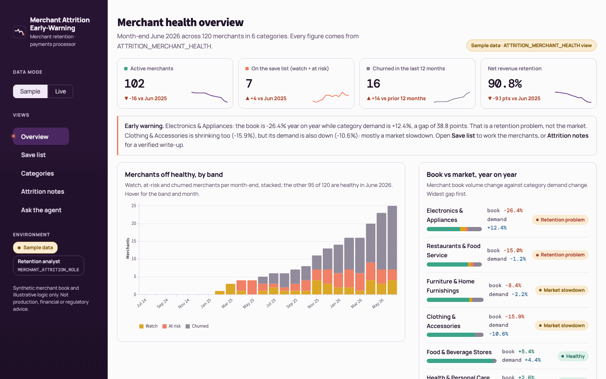

# Merchant Attrition Early-Warning: a Snow Pack

Flag the merchants whose processed volume is quietly decaying toward churn, and tell whether it's the merchant or the whole category slowing, before they leave, built on Snowflake.

Owner: Javier Soliz · Last reviewed: November 2026

**[Guide](https://sfc-gh-jsoliz.github.io/sfguide-merchant-attrition/)** · **[Try it with sample data](https://sfc-gh-jsoliz.github.io/sfguide-merchant-attrition/try/)** (no account)



## What it shows

A payments processor's merchant-retention team gets a monthly early-warning view of its merchant book:

- **Overview:** active merchants, the save list (watch + at risk), merchants churned in the last 12 months and net revenue retention (NRR), each with a trend; an early-warning note; risk bands by month; and a "book vs market" diagnosis per category.
- **Save list:** this month's watch and at-risk merchants, sortable and filterable, with the signals that flagged each one, a detail panel (volume against baseline and category demand), and an **Add to outreach queue** action.
- **Categories:** each MCC category's book against its demand backdrop, so a book shrinking while its category is *growing* stands out as a fixable **retention problem** rather than a **market slowdown**; drill into year-on-year change, tenure bands and NRR.
- **Attrition notes:** a one-page save-list note written by Cortex `AI_COMPLETE` from a fact pack of allowed numbers, checked by a second `AI_COMPLETE` pass and badged **Verified** or **Needs review**.
- **Ask the agent:** plain-English questions answered by a Cortex Agent (Cortex Analyst over the `ATTRITION_SV` semantic view), with the SQL it wrote.

Capabilities used and run live: Cortex `AI_COMPLETE`, Cortex Agents (`DATA_AGENT_RUN`), Cortex Analyst, semantic views, Streamlit in Snowflake, Snowflake SQL views.

All data is synthetic. Results such as "Electronics & Appliances is a retention problem" hold **on this synthetic data set** (see [`data/README.md`](data/README.md) for the planted stories).

## How it works

1. **Merchant health:** the `ATTRITION_MERCHANT_HEALTH` view scores every merchant every month against its baseline (volume ratio, idle days, tickets) and assigns healthy / watch / at risk / churned.
2. **Benchmark:** `ATTRITION_BENCHMARK` rolls merchants up by category, month, risk band and tenure band and joins the category demand backdrop (`ATTRITION_CATEGORY_HEALTH`).
3. **Semantic view:** `ATTRITION_SV` gives governed meaning to churn rate, NRR and demand growth.
4. **Fact pack:** the app takes the latest month and the same month a year earlier per category from `ATTRITION_BENCHMARK`; that is the note's entire allowed universe of numbers.
5. **Grounded draft and verifier:** `AI_COMPLETE` (`claude-sonnet-4-5`) writes the note under DATA RULES; a second `AI_COMPLETE` pass checks every number. Notes, verdicts, flags, the fact pack, model and latency are saved to `ATTRITION_REPORTS`.
6. **Agent:** `ATTRITION_AGENT` answers questions through Cortex Analyst over `ATTRITION_SV`; the app calls it with `SNOWFLAKE.CORTEX.DATA_AGENT_RUN`.

The demand backdrop is synthetic by default. [`sql/census_backdrop.sql`](sql/census_backdrop.sql) swaps in the free, public **US Census Advance Retail Sales** series from the Snowflake Marketplace **Financial Data Package**. The merchant book stays synthetic in both cases: a specific acquirer's merchant-level volume has no public source.

## Prerequisites

- A Snowflake account (Enterprise Edition or higher) in a region where Cortex AI functions (`AI_COMPLETE` with `claude-sonnet-4-5`) and Cortex Agents are available. Change `MODEL` in `app/ai.py` if your account uses another model.
- `ACCOUNTADMIN`, or a role that can create a role, a database and a warehouse and grant `SNOWFLAKE.CORTEX_USER`, to run setup. Everything else runs as the pack's least-privilege role.
- For the app locally: Python 3.11+ and `pip install -r app/requirements.txt` (tested with Streamlit 1.50.0, Snowpark Python 1.x, pandas 2, Altair 5).
- **Sample mode and the hosted example** need nothing: no account, no credentials.
- Optional real demand data: the free **Financial Data Package** listing (`SNOWFLAKE_PUBLIC_DATA_FINANCIAL_PACKAGE`).

## Quick start (Sample mode, no account)

```bash
git clone https://github.com/sfc-gh-jsoliz/sfguide-merchant-attrition.git
cd sfguide-merchant-attrition
pip install -r app/requirements.txt
streamlit run app/streamlit_app.py
```

The app opens in **Sample** mode on the bundled synthetic data. AI answers in Sample mode were captured from Live runs, replayed after a 4-8 s staged wait, and labeled **Sample AI response**. Or skip the install and open the [hosted example](https://sfc-gh-jsoliz.github.io/sfguide-merchant-attrition/try/).

## Live mode

1. Open [`sql/setup.sql`](sql/setup.sql) in a Snowsight worksheet and **Run All** (about 15 s on an XSMALL warehouse). It creates `MERCHANT_ATTRITION_ROLE`, grants it to you, and creates everything below as that role.
2. Register a key pair on your Snowflake user ([key-pair authentication](https://docs.snowflake.com/en/user-guide/key-pair-auth)), then:

   ```bash
   export SNOWFLAKE_ACCOUNT=<org-account>
   export SNOWFLAKE_USER=<YOUR_USER>
   export SNOWFLAKE_PRIVATE_KEY_PATH=~/.snowflake/keys/<your_key>.p8
   streamlit run app/streamlit_app.py
   ```

   The app starts in **Live** mode (switch in the left rail). It uses `MERCHANT_ATTRITION_ROLE` and `SNOWPACK_MERCHANT_ATTRITION_WH` unless you set `SNOWFLAKE_ROLE` / `SNOWFLAKE_WAREHOUSE`. If a Live query fails, the app shows the error; it never falls back to sample data. Never put keys in the repository.
3. Optional: run [`sql/census_backdrop.sql`](sql/census_backdrop.sql) after getting the Financial Data Package listing (the script lists the grant it needs). Re-run `setup.sql` to go back to the synthetic backdrop.

### Deploy the app in Snowflake

Upload the `app/` folder to the stage setup created, keeping the folder structure, then create the app (as `MERCHANT_ATTRITION_ROLE`):

```sql
-- from the repository root, with SnowSQL or the Snowflake CLI:
-- PUT file://app/* @SNOWPACK_MERCHANT_ATTRITION.CORE.APP_STAGE AUTO_COMPRESS=FALSE OVERWRITE=TRUE;  (repeat for app/views/*, app/sample/*, app/static/fonts/*, app/.streamlit/*)
CREATE OR REPLACE STREAMLIT SNOWPACK_MERCHANT_ATTRITION.CORE.MERCHANT_ATTRITION_APP
  FROM @SNOWPACK_MERCHANT_ATTRITION.CORE.APP_STAGE
  MAIN_FILE = 'streamlit_app.py'
  QUERY_WAREHOUSE = SNOWPACK_MERCHANT_ATTRITION_WH
  RUNTIME_NAME = 'SYSTEM$WAREHOUSE_RUNTIME'
  TITLE = 'Merchant Attrition Early-Warning';
```

The app finds its own session and opens in Live mode. `environment.yml` pins Streamlit 1.50.0 for the warehouse runtime.

## Customize with Cortex Code

Open this pack in Cortex Code and adapt it with prompts like:

- "Add a 90-day attrition-probability score per merchant to `ATTRITION_MERCHANT_HEALTH` and sort the Save list by it, so churn risk is ranked instead of banded. Explain the features you use first."
- "Redefine net revenue retention (NRR) to use trailing-12-month processed volume instead of the merchant's baseline, and update `ATTRITION_BENCHMARK`, `ATTRITION_SV`, the fact pack in `app/ai.py` and `app/data.py` so the app and the note agree."
- "Replace the synthetic merchant book with my settlement and engagement tables (same columns as `ATTRITION_MERCHANT` and `ATTRITION_MERCHANT_MONTHLY`). Propose least-privilege grants and a validation plan before changing any objects."

## Objects created

All in database `SNOWPACK_MERCHANT_ATTRITION`, schema `CORE`, owned by `MERCHANT_ATTRITION_ROLE`.

| Object | Type | Purpose |
|---|---|---|
| `MERCHANT_ATTRITION_ROLE` | Role | Least-privilege pack role (create database/warehouse, `SNOWFLAKE.CORTEX_USER`) |
| `SNOWPACK_MERCHANT_ATTRITION_WH` | Warehouse (XSMALL) | Dedicated compute; auto-suspend 60 s |
| `SNOWPACK_MERCHANT_ATTRITION` / `CORE` | Database / schema | Dedicated home for the pack |
| `ATTRITION_MERCHANT_CATEGORY` | Table | Category dimension (MCC → Census variable) |
| `ATTRITION_MERCHANT` | Table | Synthetic merchant master |
| `ATTRITION_MERCHANT_MONTHLY` | Table | Synthetic monthly volume and health signals |
| `ATTRITION_CATEGORY_DEMAND` | Table | Synthetic category demand series |
| `ATTRITION_CATEGORY_HEALTH` | View | Demand backdrop (synthetic; Census with `census_backdrop.sql`) |
| `ATTRITION_MERCHANT_HEALTH` | View | Per merchant and month: volume ratio, risk band, tenure band |
| `ATTRITION_BENCHMARK` | View | Category × month × risk band × tenure band, with demand |
| `ATTRITION_DATA_SOURCE_INFO` | View | Which demand backdrop is active |
| `ATTRITION_SV` | Semantic view | Governed model for Cortex Analyst |
| `ATTRITION_REPORTS` | Table | Saved notes, verdicts, flags, fact packs, latency |
| `ATTRITION_OUTREACH` | Table | Outreach queued from the Save list |
| `ATTRITION_AGENT` | Cortex Agent | Cortex Analyst over `ATTRITION_SV` |
| `APP_STAGE` | Stage | Source files for Streamlit in Snowflake |
| `MERCHANT_ATTRITION_APP` | Streamlit | Created by you in *Deploy the app in Snowflake* |

## Cost and time

Measured on an XSMALL warehouse on 2026-11-21:

- `sql/setup.sql`: 13-17 s per run.
- Attrition note (fact pack + two `AI_COMPLETE` calls + save): 7-13 s. Agent answers: 13-29 s.
- Credits: the whole build-and-test session (six setup runs and every screen in Live mode) used about 0.24 warehouse credits and about 0.07 AI credits for 22 `AI_COMPLETE` calls, roughly 0.003 AI credits per call or 0.007 per note. Agent calls add Cortex Analyst and agent orchestration usage. Check current Cortex pricing for your region.

## Known limitations

- The merchant book is synthetic in every mode; the category demand backdrop is synthetic unless you run `census_backdrop.sql`. `census_backdrop.sql` is the original pack's real-data query; it was not re-run in the v2 live verification because the listing was not available in the test account.
- Risk bands are threshold rules, not a predictive model.
- The verifier is a second model pass, not a guarantee: on the synthetic data 5 of 7 captured notes verified, and the 2 flags were real (a wrong "13×" ratio and a hedged recommendation).
- Sample mode keeps the outreach queue in the browser session only; Live mode writes it to `ATTRITION_OUTREACH`.
- The hosted example is always Sample mode, with AI answers captured from Live runs.
- Illustrative example, not a production system. Validate AI output and involve the relevant business owner before relying on it.

## Cleanup

Run [`sql/cleanup.sql`](sql/cleanup.sql) as the user who ran setup. It drops the database (tables, views, semantic view, agent, stage, Streamlit app) and the warehouse as `MERCHANT_ATTRITION_ROLE`, then drops the role as `ACCOUNTADMIN`.

## Repository layout

```text
app/            Streamlit app: streamlit_app.py, data.py (Sample/Live), ai.py, brand.py, views/, sample/
data/           Seeded generator (generate.py), CSVs, planted stories (README.md)
sql/            setup.sql, census_backdrop.sql (optional), cleanup.sql
docs/           Guide (index.html), hosted example (try/), DESIGN.md, images, catalog cards
notebook/       Step-by-step lab of the grounded-note loop
scripts/        build_example.py (npm run build:example), capture_sample.py, check_contrast.py
```

Rebuild: `python3 data/generate.py` (data and the setup.sql INSERT block), `python3 scripts/capture_sample.py` with Live env vars (Sample AI responses), `npm run build:example` (docs/try/data.js, fonts, docs/.nojekyll).

## Learn more

- [Cortex AI functions (`AI_COMPLETE`)](https://docs.snowflake.com/en/user-guide/snowflake-cortex/aisql)
- [Cortex Agents](https://docs.snowflake.com/en/user-guide/snowflake-cortex/cortex-agents)
- [Cortex Analyst](https://docs.snowflake.com/en/user-guide/snowflake-cortex/cortex-analyst) and [semantic views](https://docs.snowflake.com/en/user-guide/views-semantic/overview)
- [Streamlit in Snowflake](https://docs.snowflake.com/en/developer-guide/streamlit/about-streamlit)

## License

Apache 2.0 (see [`LICENSE`](LICENSE)). Illustrative example, provided as-is, not supported by Snowflake Support. This is not an official Snowflake product. Contains no customer data. Review and test before any production use.
